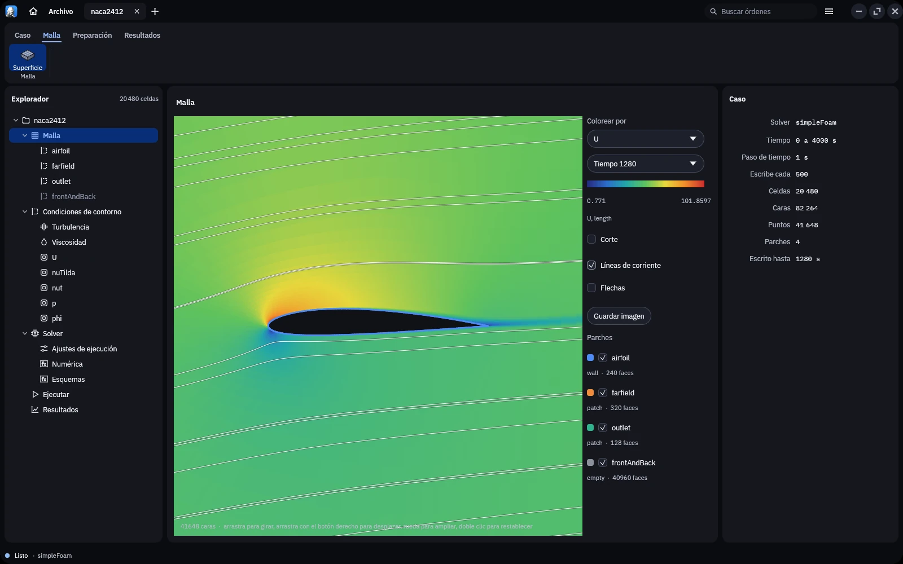
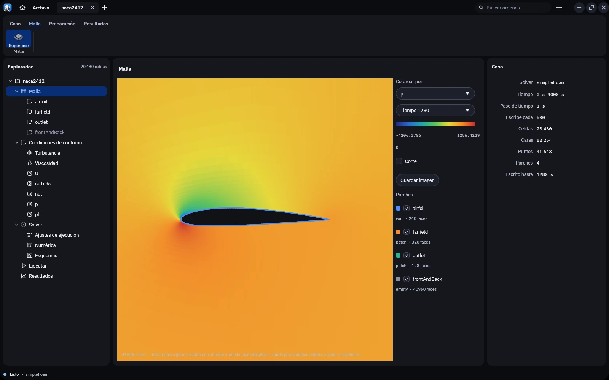

<div align="center">
  <a href="https://getnodalia.com">
    
  </a>
  <br><br>
  
  <h1>Vortia</h1>
  <p><strong>A free desktop application for CFD simulation, from geometry to post-processing, written in Rust with its own engine.</strong></p>

  <p>
    
    
    
    
    <a href="./LICENSE"></a>
  </p>

  <p>
    <a href="#overview">Overview</a> ·
    <a href="#screenshots">Screenshots</a> ·
    <a href="#what-it-does">What it does</a> ·
    <a href="#installation">Installation</a> ·
    <a href="#verification">Verification</a> ·
    <a href="#building-from-source">Build</a> ·
    <a href="#project-status">Status</a> ·
    <a href="#documentation">Docs</a> ·
    <a href="#contributing">Contribute</a>
  </p>
</div>

<p align="center">
  
</p>

---

## Overview

**Vortia** is a desktop application written entirely in Rust, with a
finite-volume CFD engine of its own derived from OpenFOAM's methods, that takes
one workflow from geometry to results: sketch or box → mesh → physics →
supervised run → results, without touching the terminal. It needs no OpenFOAM,
MPI, Python or Gmsh: the engine, the 2D mesher and the interface are Rust.

Since 0.11.0 this is the application the releases ship. The earlier C++/Qt
application and the macOS edition Vortia Native (SwiftUI), which drove OpenFOAM,
were removed from the repository once the Rust version covered everything they did;
their source stays in the git history
([`docs/architecture/rust-only.md`](docs/architecture/rust-only.md)).

Vortia is a Nodalia app maintained by one person. It does not have parity with commercial CFD suites, and it says so: every
limit is listed in
[`docs/KNOWN_LIMITATIONS.md`](docs/KNOWN_LIMITATIONS.md).

> [!IMPORTANT]
> **Vortia is experimental.** Always check convergence, mass balance and mesh
> dependence, and read [`docs/KNOWN_LIMITATIONS.md`](docs/KNOWN_LIMITATIONS.md)
> and [`docs/VALIDATION.md`](docs/VALIDATION.md) before trusting a result. The
> native cases are numerical verification, not validation of a design.

## Screenshots

| | |
|---|---|
|  |  |
| Geometry: a nozzle drawn with the sketch's generator | Results: speed field of a jet |
|  |  |
| Main menu: Preferences, Keyboard Shortcuts, About | Preferences, with Nodalia or desktop window controls |

|  |  |
| Results: speed and streamlines around a NACA 2412 at 8° | Results: pressure, with the suction peak over the nose |

The jet's results view shows the `examples/nozzle-practice-2026` case; the sketch is a
nozzle made with the sketch's generator. The airfoil pictures come from
`vortia new airfoil DIR naca=2412 alpha=8` and `vortia solve DIR` (about a minute on one
core: 20 480 cells, converged in 1 280 iterations, C_L 1.066, C_D 0.0141, one mesh,
no validation). `geometry-light.webp` and
`results-speed-light.webp` are the same views in light mode. These are interface
captures, not validation: see [`docs/VALIDATION.md`](docs/VALIDATION.md).

## What it does

| Area | Vortia 0.14.0 | Evidence |
|---|---|---|
| Geometry | Rectangular domains, planar and axisymmetric nozzles, a region drawn on a canvas (lines, arcs, dimensions, saved sketch); STL, OBJ, STEP (assemblies included) and DXF files read; a part modelled in the app on Nodalia's solid kernel (primitives, outlines, NACA wings, boolean operations, rounds and chamfers) saved as `.vortia-part` and exported to STL and STEP; Fluent `.cas.h5` viewing | Software tests |
| Meshing | Structured block meshes with grading, checked against `blockMesh`; its own 2D mesher for a drawn region; a first-stage octree mesher for flow around a closed 3D body (no prism layers yet; sphere at Re 100 is 3–4 % above the published drag); Fluent `.msh` and `.cas.h5` import | Compared with OpenFOAM v1912 |
| Incompressible laminar | Transient `icoFoam` (fixed or adaptive time step) and steady `simpleFoam` | Poiseuille, Ghia cavity; adaptive step against a fixed step |
| RANS turbulence | Steady k-ω SST and Spalart–Allmaras with wall functions; NACA 4-digit airfoils with C_L, C_D, C_m, C_p and C_f | Flat plate against a correlation, `simpleFoam` agreement; NACA 0012 against thin-airfoil theory (C_D 16–27 % high) |
| Heat transfer | Passive temperature in `simpleFoam`, laminar and turbulent, with wall heat flux | Heated plate against Pohlhausen (+3.3 %) and the turbulent flat-plate correlation (−13.3 %) |
| Compressible | `rhoSimpleFoam` for nozzles and jets, natural convection of a Boussinesq fluid | Compared with OpenFOAM v1912 on the same meshes; de Vahl Davis cavity |
| Post-processing | Fields, slices, streamlines, probes, lines, wall quantities, section analysis with HTML/CSV/JSON report, comparison between runs, CSV and VTK export | Software tests |
| Verification | Three-mesh GCI, flow-rate balance, run diagnostics | Software tests |

Not available: LES/DES, radiation and conjugate heat transfer (solid–fluid), multiphase, combustion,
moving meshes, prism layers and IGES import, remote or HPC runs,
the results of Fluent `.dat.h5` files, and parallel runs. The
full table, with what "evidence" means, is in the capability matrix.

## Installation

Packages are published on the [Releases page](https://github.com/danielmigueltejedor/vortia/releases).

| System | File | Requirements |
|---|---|---|
| macOS | `Vortia-<version>-macos-arm64.dmg` | Apple Silicon. Ad-hoc signed and not notarised: the first time, right-click → Open |
| Linux | `Vortia-<version>-linux-x86_64.AppImage` | x86_64, glibc 2.35 or later. Give it execute permission and open it |
| Linux | `Vortia-<version>-linux-x86_64.tar.gz` | The app and the `vortia` command-line tool, without an AppImage |

Each file has its SHA-256 sum in a `.sha256` file. The AppImage needs FUSE
(`fusermount`); without it, run it with `--appimage-extract-and-run`. The app
checks for updates once a day and from its menu.

## Command line

`vortia` makes, runs and inspects cases without the interface: `vortia new`,
`vortia solve`, `vortia probe`, `vortia sample`, `vortia patch`, `vortia flux`,
`vortia wall`, `vortia streamline`, `vortia export`. `vortia help` lists them.

## Verification

The verification cases (Poiseuille, Ghia cavity, Blasius, turbulent flat plate,
three-mesh GCI) run in `cargo test`; their tolerances are in
[`docs/VALIDATION.md`](docs/VALIDATION.md). A case that finishes is not a
verified case: only those compared against their reference within a tolerance
set beforehand count.

## Building from source

**Stack:** Rust (stable, edition 2024) · egui · `nodalia-theme`

```sh
cargo build --release --manifest-path rust/Cargo.toml -p vortia-app -p vortia-cli
cargo test --manifest-path rust/Cargo.toml
./rust/target/release/vortia-app
```

`rust/packaging/linux/package.sh` and `rust/packaging/macos/package.sh` make the
AppImage, the tarball and the DMG the releases carry.

### Application icon

`resources/icons/vortia.png` (512 px) is the application icon, so the window and the
Dock use the same design. It sits on the Nodalix app grid, like the Colloid icons around it: a
tile of 224/256 with a 16 px margin, a 51.5 px radius and a soft shadow, made
by `tools/nodalia-app-icon.py` in nodalix-icon-theme. `resources/icons/vortia-macos.png` is the same artwork at full bleed, and
`resources/icons/vortia-macos-icon.png` (1024 px) the same tile at that size, which the macOS
bundle's `Vortia.icns` and the DMG volume use because macOS does not mask app icons.

The icon is a black-and-white portrait of Daniel Bernoulli over blue, part of
the Nodalia icon family. The source is an 18th-century portrait in the public
domain (ETH-Bibliothek, Wikimedia Commons, `ETH-BIB-Bernoulli, Daniel (1700-1782)-Portrait-Portr 10971.jpg`).

## Project status

Version **0.14.0**, experimental. What does not work yet:

- [`docs/KNOWN_LIMITATIONS.md`](docs/KNOWN_LIMITATIONS.md) — engine and application restrictions
- [`docs/ROADMAP.md`](docs/ROADMAP.md) — what comes next
- [`CHANGELOG.md`](CHANGELOG.md) — changes by version; the release notes of each version are in [`docs/release-notes/`](docs/release-notes/README.md)

## Documentation

The project documentation is written in Spanish.

- Architecture: [`docs/architecture/`](docs/architecture/)
- Technical research and licences: [`docs/architecture/research.md`](docs/architecture/research.md)
- Validation: [`docs/VALIDATION.md`](docs/VALIDATION.md)
- Fluent interoperability: [`docs/FLUENT_COMPATIBILITY.md`](docs/FLUENT_COMPATIBILITY.md)

## Contributing

Issues and pull requests are welcome. [`CONTRIBUTING.md`](CONTRIBUTING.md)
sets the rules; the three that are not negotiable:

1. **No façades.** Every feature has real, tested behaviour or is explicitly labelled as not implemented.
2. **Scientific rigour.** No CFD capability is announced without verification or validation documented in `docs/VALIDATION.md`.
3. **No fictitious data** in flows presented as real. Test doubles live only in `tests/`.

## License

GPL-3.0-or-later. See [`LICENSE`](LICENSE); the dependency compatibility
review is in `docs/architecture/research.md` §8.

## Trademark notice

Vortia is an original brand and implementation, unrelated to ANSYS, Inc.
ANSYS and Fluent are trademarks of their respective owners. OpenFOAM is a
trademark of OpenCFD Ltd; Vortia is not approved or endorsed by OpenCFD.
