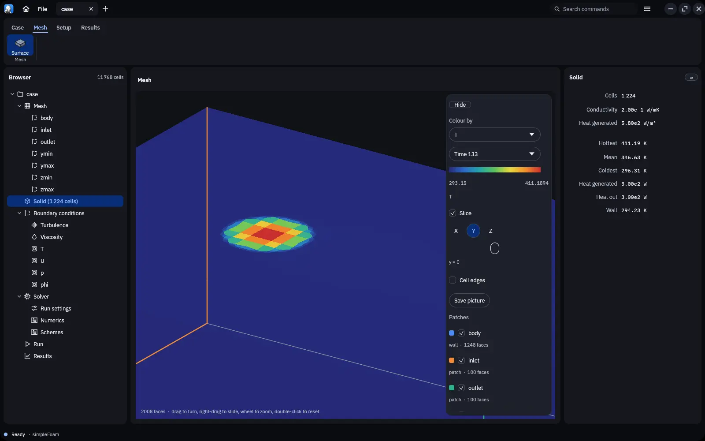

# Conjugate heat transfer: how Vortia will do it

Item 4 of Tier 1 in [`professional-roadmap.md`](professional-roadmap.md): a solid body that
conducts heat, in contact with a fluid that carries it away. *Done when* a plate fin matches
the analytic fin solution and a heated block in a channel matches OpenFOAM's
`chtMultiRegionFoam`.

## What exists

- The fluid side: `T` in `simpleFoam` (`vortia-solvers/src/heat.rs`), `α_eff = ν/Pr + ν_t/Prt`,
  wall heat flux in the wall report, a heated-plate validation.
- A steady conduction solver (`laplacianFoam`, `vortia-solvers/src/laplacian.rs`).
- The body mesher (`vortia-mesh::bodymesh`): an octree of the flow domain from which the cubes
  inside the body are removed. Those cubes are exactly the solid, and the faces between them
  and the air are exactly the `body` wall.

## The method

**Two regions, one interface, an iteration between them** (the way `chtMultiRegionFoam`
couples regions), rather than one domain with the solid blocked out of the momentum and
pressure equations. A blocked solid inside the flow solver means a mask in every matrix of
every solver; two regions leave the flow solvers as they are and add one new solver and one
new boundary condition.

1. **The solid mesh.** The same octree gives the cubes inside the body. They become a
   polyhedral mesh in `constant/solid/polyMesh` with the interface patch `body`, whose faces
   are the fluid's wall faces turned over and whose points are the fluid's snapped points,
   so both sides see one surface and the interface flux is conservative by construction.
   Where there are prism layers on the fluid side they stay on the fluid side; the solid
   starts at the wall.
2. **The solid solver.** Steady (then transient) conduction `∇·(k ∇T) + Q = 0` with `k` per
   region from a small table of materials (`constant/solid/solidProperties`: `k`, and `ρ`,
   `Cp` for the transient case), an interface patch, and the usual thermal conditions on the
   solid's other faces (there are none when the body is closed: the heat has to leave through
   the interface, so volumetric `Q` or a fixed `T` patch is how it enters).
3. **The coupling.** On the fluid side the wall takes a *mixed* (Robin) condition built from
   the solid: `T_w` from the solid's face temperature and the solid's own conductance
   `k_s / δ_s` against the fluid's `α_eff / δ_f`, as `turbulentTemperatureCoupledBaffleMixed`
   does. Fluid and solid are solved in turn, the interface temperature relaxed, until the
   interface heat flux from both sides agrees to a tolerance. The flow does not depend on `T`
   (no buoyancy), so the flow is solved once and the coupling loop only iterates the two
   temperature equations: cheap.
4. **The case.** `vortia new body DIR FILE solid=NAME [heat=W]` writes both regions, the
   material and the heating; the report gives the heat leaving through the wall and the
   maximum temperature of the solid.
5. **The window.** The solid is a second item in the Browser tree, with its own properties
   (conductivity, heating, and after a run its temperatures and the heat through its wall); the
   3D view colours it with `T` and a section cuts through both on one colour scale.

   

## Steps, each one a pull request with its own test

| Step | What | Done when |
|---|---|---|
| C1 | Solid mesh from the octree's inside cubes, with the interface patch matching the wall | `check-mesh` passes on both regions; the interface faces of both sides are the same faces with opposite orientation; areas agree |
| C2 | Conduction in a region with `k` per region and interface conditions | A slab with fixed `T` on two sides gives the linear profile; a plate fin with a fixed convective coefficient matches the analytic fin solution |
| C3 | Fluid wall Robin condition from the solid and the coupling loop | A conducting sphere in a stream reaches a steady `T` whose heat balance closes to 1 % between the two sides |
| C4 | `vortia new body ... solid=` and the report | The case runs from the command line and the report prints heat flow and peak temperature |
| C5 | The window: the solid in the tree, the 3D view | A screenshot of a heated body with its cut |
| C6 | Validation: a heated sphere against hand calculation (done); against OpenFOAM's `chtMultiRegionFoam` on a heated block in a channel (needs OpenFOAM, not run) | Interior temperature and film within a few per cent of theory; recorded in `docs/VALIDATION.md` (case 9) |

C2 can start at once and is independent of C1; C3 needs both.

## What this does not do (yet)

Buoyancy and radiation, transient coupling, solids that move, several solids with their own
materials meeting each other, and thin walls with a resistance (baffles) are later steps.
